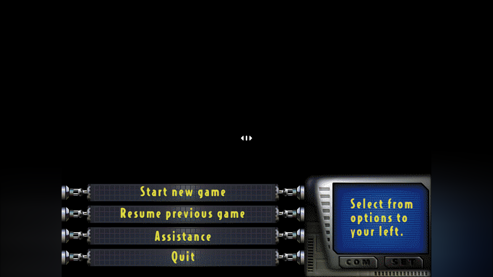
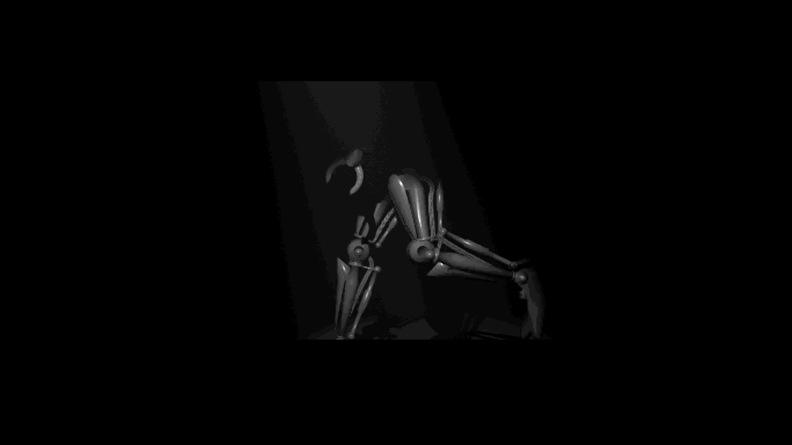
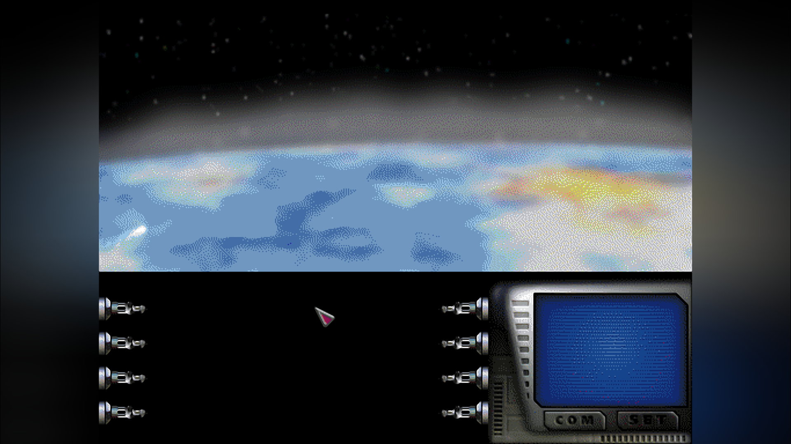
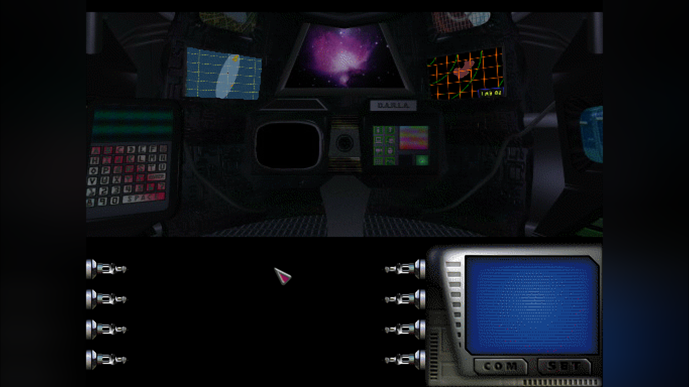
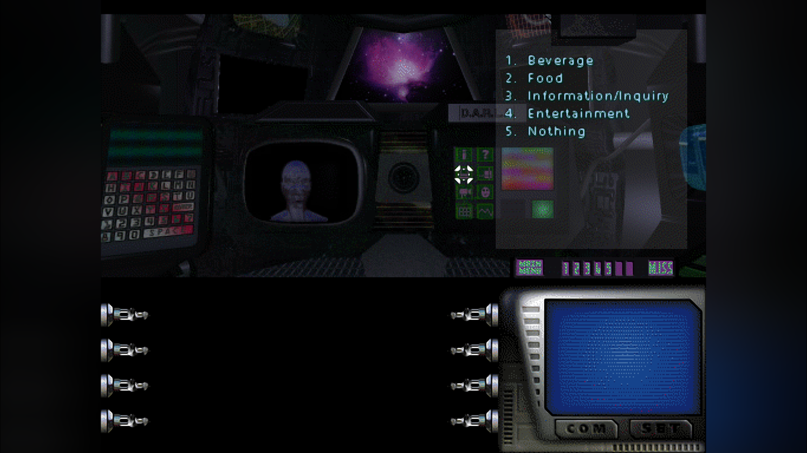
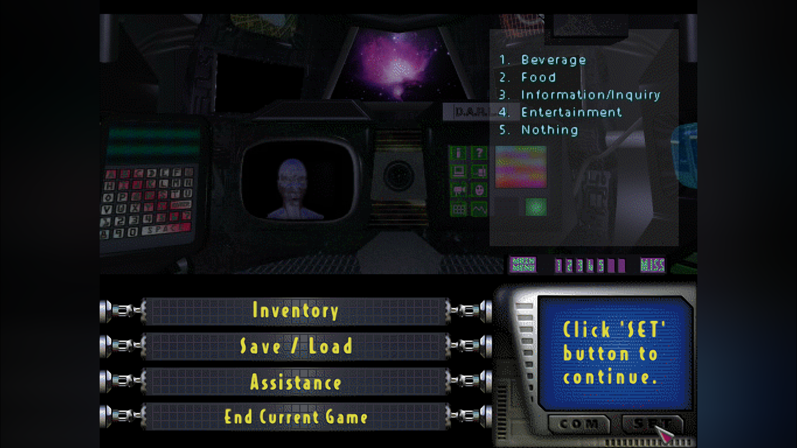

# Isaac Asimov's Robot City — PC Native

The 1995 Windows 3.1 adventure **Isaac Asimov's Robot City** (Byron Preiss
Multimedia / Brooklyn Multimedia) running natively on modern 64-bit Windows,
without an emulator.

The game's own 16-bit program, `ROBOTCTY.EXE`, is recompiled to C. Its code
runs as native x64 code on top of a small layer of our own that stands in for
Windows 3.1 (KERNEL, USER, GDI, MMSYSTEM, WinG). No game files are in this
repository: you need your own two Robot City CDs.



## Screenshots

| | |
|---|---|
|  |  |
|  |  |
|  |  |

## What you get

- The original game itself: the game's own code, pictures, animations,
  speech and music.
- **Fills the screen**: the game area is zoomed to the window or monitor,
  instead of a small box inside a 640x480 frame (*Video > Zoom to the game
  area*).
- **Widescreen fill**: on a wide monitor the picture stays sharp and
  undistorted in the middle, and the sides show a soft blur of the scene
  instead of black bars. Press **F9** to switch it on or off.
- Modern upscale filters (edge-adaptive, bicubic, xBR, sharp bilinear …),
  sharpening and FXAA (*Video* menu); fullscreen with **Alt+Enter**.
- Steady cursor: the original arrow cursors blink through an empty frame;
  here they just stay visible.
- The 2-minute introduction can be skipped with a click (the original
  ignored the click).

## Installing

Run **Robot City PC Setup.exe** and point it at your two CDs. Discs in a
drive, ISO / BIN+CUE images, or folders with the disc contents all work. Setup
copies both discs to the hard disk (about 920 MB), so after installing the
game never asks for a CD again. It puts your CD's icon on the game and adds
Start menu / desktop shortcuts and an uninstaller.

Silent install: `"Robot City PC Setup.exe" /silent /cd <disc 1> /cd2 <disc 2>
/dir <folder> [/nodesktop] [/nostartmenu]`.

## Status

Playable from the introduction through the first locations; under testing.

## Building

Requirements: Windows 10/11 x64, [MSYS2](https://www.msys2.org/) with the
MinGW64 gcc toolchain, Python 3 with `capstone` (`pip install capstone`).
[Ghidra](https://ghidra-sre.org/) is optional: its function list is in
`re/robotcty/functions.tsv`.

1. Put the game files in place from your two CDs (drive letters or folders
   with the disc contents):

   ```
   python tools/setup_game.py D:\ E:\
   ```

2. Copy `game/hd/RC/ROBOTCTY.EXE` to `gamedata/robotcty.exe` (the recompiler
   reads the program from there).
3. From an MSYS2 MinGW64 shell:

   ```
   make gen      # recompile ROBOTCTY.EXE to C (src/gen) and make the API glue
   make -j8      # build RobotCity.exe
   ```

4. Run `PLAY.bat` (settings in `robotcity.ini`, log in `robotcity.log`).

## How it works

- `tools/ne.py` reads the 16-bit NE executable (segments, relocations,
  imports, resources).
- `tools/recomp16.py` is a 16-bit x86 → C static recompiler. It covers
  segmented addressing, far and near calls, NE relocations, MSVC switch
  tables, and finds callbacks through prologue scanning. `tools/patch16.txt`
  holds small C fixes at single instructions, and `tools/trace16.txt` logs
  registers for debugging.
- `tools/gen_api16.py` generates the glue for the 95 Windows functions the
  game imports, so every API is a plain C function (`w16_GlobalAlloc`, …).
- `src/rt/` is the runtime: selectors and global memory with huge
  pointers, the NE loader (the game's code is loaded from your CD at run
  time), DOS file services, the window and message queue, GDI and WinG on
  an 8-bit screen, waveOut on the Windows audio device, and the Direct3D 9
  presenter.

## Credits and legal

Robot City © 1995 Byron Preiss Multimedia Company, Inc. This project contains
no game data and is not affiliated with the rights holders; you need your own
copy of the game.

The Windows 3.1 API ordinal tables in `re/winspec/` are the Wine project's
`.spec` files (LGPL), used only to name the imported functions.
